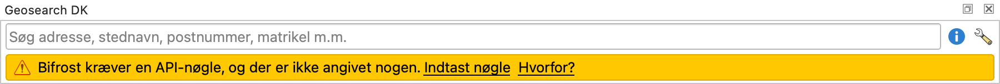
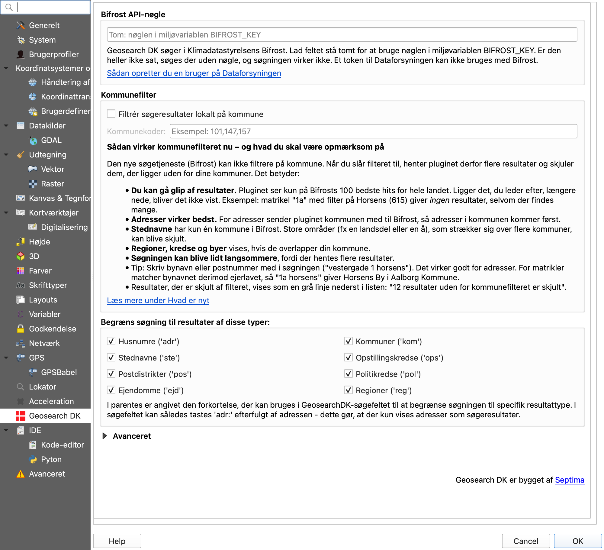

Geosearch DK
==============

QGIS-plugin der tilføjer en søgeboks der anvender offentlige data, som tillader brugeren lynhurtigt at zoome til navngivne steder i Danmark - f.eks. adresser, stednavne, kommuner.

Pluginet er udviklet af [Septima](http://www.septima.dk) og stilles frit og gratis til rådighed for QGIS-brugere under GNU General Public License v3.0, se nærmere i afsnittet [Ophavsret og videredistribution](#ophavsret-og-videredistribution).

Overgang til Bifrost
--------------
Klimadatastyrelsen lukker søgetjenesten [GSearch](https://github.com/Klimadatastyrelsen/gsearch) i november 2026. Fra version 4.0 bruger Geosearch DK derfor Klimadatastyrelsens nye søgetjeneste, **Bifrost**. Det meste virker som før, men der er nogle forskelle. Efter opdateringen viser søgepanelet en lille blå bjælke med et link til forskellene, og du kan altid finde dem igen under ⓘ-knappen i søgepanelet.

**Du skal bruge en nøgle til Bifrost**\
Bifrost kræver sin egen API-nøgle. Et token til Dataforsyningen kan ikke bruges, så pluginet har fjernet det token, du måske havde angivet i den gamle version.
Pluginet har ingen indbygget nøgle, så du skal selv oprette en nøgle og indtaste den. Så længe der ingen nøgle er, viser søgepanelet en gul bjælke. Klik på *Indtast nøgle* i den gule bjælke eller på skruenøglen i søgepanelet (eller vælg *Indstillinger → Indstillinger → Geosearch DK*), og indsæt den under **Bifrost API-nøgle**. [Sådan opretter du en bruger på Dataforsyningen](https://www.klimadatastyrelsen.dk/data/dataforsyningen/vi-fremtidssikrer-dataforsyningen). Din IT-afdeling kan også sætte nøglen for alle med miljøvariablen `BIFROST_KEY`.

**Vigtigt: Matrikelnumre er blevet til ejendomme**\
Bifrost kan ikke søge i matrikler, kun i ejendomme. Søgetypen **Matrikelnumre** hedder derfor nu **Ejendomme**. Når du søger på et matrikelnummer, finder du hele ejendommen (BFE), som matriklen hører til, og kortet viser hele ejendommen, ikke kun matriklen. Det præcise matrikelnummer står øverst i listen. Ligger ejendommen på flere matrikler, står det i listen, fx *3kg, Vangede (del af ejendom med 27 matrikler)*. Skriv `ejd:` foran for kun at søge i ejendomme, fx `ejd: 3kg søllerød`. `mat:` virker stadig. [Se eksempler](https://github.com/AsgerPetersen/qgis-geosearch/blob/master/docs/forskelle-gsearch-bifrost.md#matrikel)

**Nyt**
- **Lejligheder:** Du kan nu finde adresser med etage og dør.

**Virker anderledes**
- **Teksten i resultatlisten** laves nu af pluginet. Stednavne vises som *navn (type, kommune)*, fx *Skodsborg (bebyggelse, Rudersdal)*.
- **Kortet** zoomer først til et punkt. Den fulde geometri, fx en vej eller en ejendom, kommer et øjeblik efter.
- **Kommunefilteret** er nu et valg, du selv slår til i indstillingerne. Bifrost kan ikke filtrere på kommune, så pluginet henter resultater for hele landet og skjuler dem uden for dine kommuner. Vær opmærksom på:
  - Du kan gå glip af resultater. Pluginet ser kun på Bifrosts 100 bedste hits for hele landet. Fx giver matrikel *1a* med filter på Horsens (615) ingen resultater, selvom der findes mange. [Se eksempler](https://github.com/AsgerPetersen/qgis-geosearch/blob/master/docs/forskelle-gsearch-bifrost.md#kommunefilter)
  - Adresser virker bedst, fordi pluginet sender kommunen med til Bifrost.
  - Store stednavne, fx en å eller en landsdel, kan blive skjult, fordi de kun hører til én kommune.
  - Brugte du kommunefilteret i den gamle version, er det slået til. Du kan slå det fra i indstillingerne.

**Virker ikke længere – og hvorfor**
- **Søgning på dele af ord.** *nørrebrog* finder ikke længere Nørrebrogade. Skriv hele ord, fx *nørrebrogade 1 københavn*. Til gengæld retter Bifrost små stavefejl.\
  *Hvorfor: Bifrost tilbyder det ikke.* [Se eksempler](https://github.com/AsgerPetersen/qgis-geosearch/blob/master/docs/forskelle-gsearch-bifrost.md#delord)
- **Kommunefilter i søgetjenesten.** GSearch filtrerede på kommune, så du fik alle hits i dine kommuner. Nu filtrerer pluginet selv, og det kan give færre resultater (se Kommunefilteret ovenfor).\
  *Hvorfor: Bifrost tilbyder det ikke.*
- **Stednavnets undertype.** GSearch viste fx *Skodsborg (By i Rudersdal Kommune)*. Nu vises kun en overordnet type, fx *bebyggelse* eller *naturareal*, så steder med samme navn kan være svære at skelne.\
  *Hvorfor: Bifrost tilbyder det ikke.* [Se eksempler](https://github.com/AsgerPetersen/qgis-geosearch/blob/master/docs/forskelle-gsearch-bifrost.md#visningstekst)

Konkrete eksempler, optaget fra begge tjenester før GSearch lukkede, står i [Forskelle mellem GSearch og Bifrost](https://github.com/AsgerPetersen/qgis-geosearch/blob/master/docs/forskelle-gsearch-bifrost.md). Dokumentet og optagelserne ligger i forken [AsgerPetersen/qgis-geosearch](https://github.com/AsgerPetersen/qgis-geosearch), hvor overgangen til Bifrost er udviklet.

Teksten i pluginet findes i [src/geosearch_dk/help/hvad_er_nyt.html](src/geosearch_dk/help/hvad_er_nyt.html) og på engelsk i [hvad_er_nyt.en.html](src/geosearch_dk/help/hvad_er_nyt.en.html), som vises, når QGIS kører på engelsk.

Installation af pluginet
--------------
Pluginet er tilgængeligt fra QGIS' officielle plugin repository, dermed finder en installation af QGIS selv en kompatibel version af pluginet.

Det letteste er at installere pluginet via QGIS. Dette gør du således:
   * Under menuen 'Plugins', vælg 'Administrér og Installér Plugins...' (I den engelske version af QGIS hedder denne menu 'Manage and Install Plugins...')
   * I Plugins-dialogen, søg efter 'Geosearch DK'
   * Vælg 'Geosearch DK' i listen (så denne bliver markeret med blå)
   * Klik på 'Installér Plugin'. Derefter installeres pluginet.

Pluginet installerer et QGIS-panel med en søgeboks, der som udgangspunkt lægger sig oven for kortvinduet. Panelet kan flyttes, så det f.eks. ligger oven for lagpanelet i stedet. På denne placering fylder det ikke så meget, men er stadig let tilgængeligt.

Hvis man trykker på krydset i Geosearch DK-panelet bliver det deaktiveret og forsvinder helt fra visningen, men kan nemt genaktiveres ved at sætte flueben ved det under menupunktet Visning->Paneler (på engelsk View->Panels).

Pluginet kræver en API-nøgle til Bifrost (se [Overgang til Bifrost](#overgang-til-bifrost)). Nøglen angives under pluginets indstillinger, som findes ved at gå til menupunktet Indstillinger->Indstillinger->Geosearch DK (engelsk Settings->Options) eller bruge genvejen via skruenøgle-ikonet i panelet.

Opdatering af pluginet
--------------
Nye versioner af pluginet udstilles via QGIS' officielle plugin repository. I Plugin Manageren vil opdateringer fremgå under punktet Upgradeable. Automatisk advisering om opgraderbare plugins kan aktiveres under Settings i Plugin Manageren.

Vil du selv opdatere dit plugin, så gør således:
   * Åbn pluginsdialogen
   * Søg efter 'GeosearchDK'
   * Vælg GeosearchDK i listen
   * Klik på 'Opgradér Plugin'. Derefter opgraderes pluginet til den nyeste version.

Indstillinger
-----------------
Du kan lave en række indstillinger i pluginets indstillingsfane, som du kan åbne ved at klikke på skruenøgle-ikonet (eller gå til menupunktet Indstillinger->Indstillinger->Geosearch DK (engelsk Settings->Options)):

Følgende indstillinger kan foretages i pluginets indstillingsdialog:
- Bifrost API-nøgle. Se [Sådan opretter du en bruger på Dataforsyningen](https://www.klimadatastyrelsen.dk/data/dataforsyningen/vi-fremtidssikrer-dataforsyningen). Står feltet tomt, bruges miljøvariablen `BIFROST_KEY`. Et token til Dataforsyningen kan ikke bruges.
- Kommunefilter. Indtast et eller flere kommunenumre adskilt af komma. Pluginet skjuler så søgeresultater uden for de listede kommuner. Læs om begrænsningerne under [Overgang til Bifrost](#overgang-til-bifrost).
- Typefilter. Vis kun søgeresultater af bestemte typer, f.eks. adresser, ejendomme, stednavne etc.

Oplever du fejl eller har du ønsker til forbedringer eller ny funktionalitet?
-----------------
Der er allerede en række forslag til forbedringer i projektets [Issuetracker](../../issues).

Har du en idé til en forbedring eller har du måske opdaget en bug i pluginet, så vil Septima med glæde tilbyde sin bistand.

Du kan registrere din idé eller bug i projektets [Issuetracker](../../issues). Her kan du også se eksisterende registreringer af idéer og bugs.

Udvikling
-----------------
Se [docs/development.md](docs/development.md) for hvordan pluginet køres fra en checkout i en separat QGIS-profil (`make dev`), og for den visuelle kørsel og den manuelle tjekliste.

Ophavsret og videredistribution
-------------------------------
Pluginet er udviklet af [Septima](http://www.septima.dk), som er primær ophavsretsindehaver men som har givet tilladelse til distribution under betingelserne i Open Source/Fri Software-licensen [GNU General Public License v3.0](http://www.gnu.org/licenses/gpl.html) eller senere ([GPL3.0-or-later](https://spdx.org/licenses/GPL-3.0-or-later)).

Det indeholder dog også kode fra projektet [QGIS Setting Manager](https://opengisch.github.io/qgis_setting_manager/) (under stien `src/geosearch_dk/config/qgissettingmanager/`) som kan distribueres under licensen [GNU General Public License v2.0](https://www.gnu.org/licenses/old-licenses/gpl-2.0.html) eller senere ([GPL2.0-or-later](https://spdx.org/licenses/GPL-2.0-or-later)).

Ophavsretsinformation og licensbetingelser for en konkret fil kan altid ses i toppen af den enkelte fil.
